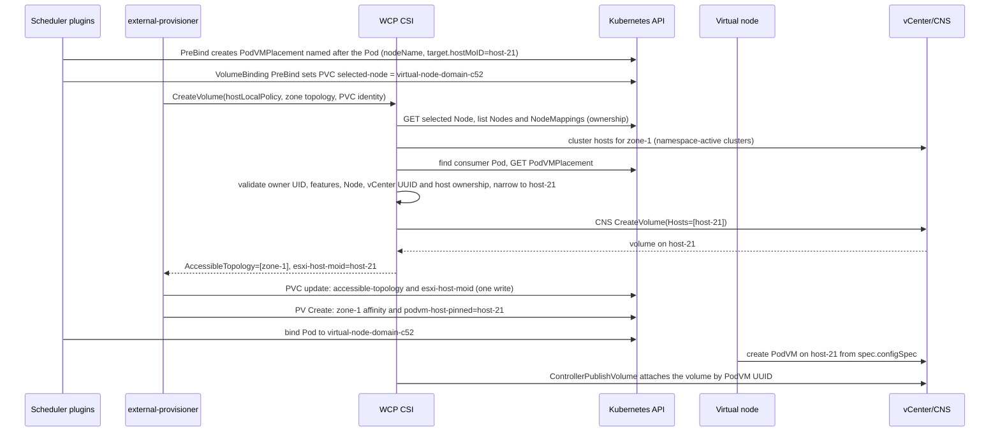

# PodVM v2: vSphere CSI changes for host-local volumes

Status: Draft, Milestone 3 (M3)
Branches: `podvmv2-hostlocal-csi-changes` in vSphere CSI Driver and in the Supervisor external-provisioner
Scope: Supervisor CSI (WCP flavor), PVCSI (guest flavor), the CSI syncer, and the Supervisor external-provisioner
Builds on: [PodVM v2: vSphere CSI changes for zonal (shared) volumes](../podvmv2-changes-for-zonal-volume/design.md) (M1)

## 1. Summary

A host-local volume lives on a datastore that exactly one ESXi host mounts. The volume can be used
only by a VM that runs on that host. Today a Supervisor host-local PV expresses that restriction as
`kubernetes.io/hostname` node affinity, naming the dedicated ESXi Node that represents the host.
PodVM v2 breaks that representation in two ways:

1. **The Node name goes away.** When an ESXi host is upgraded, its dedicated Node is deleted and
   the host is represented by the cluster's VirtualNode. A PV whose immutable affinity names the
   deleted Node can never be scheduled again.
2. **A VirtualNode cannot name a host.** It represents a whole vSphere cluster, so neither its name
   nor its topology identifies the one host that can use a host-local volume.

This milestone replaces Node names with **physical ESXi host MoIDs** wherever a host-local volume's
location is stored or transported:

- **Supervisor PV**: zone-only node affinity plus a mandatory scheduler pin,
  `cns.vmware.com/podvm-host-pinned: <host MoID>`, written on the initial PV object.
- **VKS (guest) topology**: `topology.csi.vmware.com/host` carries the host MoID, not a Supervisor
  Node name, in both Supervisor modes.
- **Direct PodVM WFFC on a VirtualNode**: the committed host comes from the scheduler's
  `PodVMPlacement` resource before the PodVM exists.

The contract is selected by **HostLocalStorage alone**, before or after PodVM v2 is enabled and
before or after any VirtualNode appears. All new host-local PVs therefore survive the later
ESXi-to-VirtualNode transition without an affinity migration.

Shared/zonal volumes are unchanged by this milestone. They were covered in M1.

## 2. Background: host-local storage today

```text
 VKS guest                                  Supervisor
 ┌──────────────────────────┐               ┌───────────────────────────────────────────┐
 │ Node worker-a            │  PVCSI        │ PVC (requested-topology annotation)       │
 │   zone=zone-1            │ ───────────▶  │   [{zone: zone-1,                         │
 │   csi.vmware.com/host=   │  translate    │     kubernetes.io/hostname: esx-node-21}] │
 │     esx-node-21          │  host key →   │                                           │
 │ (Supervisor Node name)   │  hostname     │ PV affinity: zone-1 AND hostname=         │
 └──────────────────────────┘               │              esx-node-21                  │
                                            └───────────────────────────────────────────┘
                                                      │ 1:1
                                                 ESXi host-21 (host-local datastore)
```

- The Supervisor StorageClass annotation `cns.vmware.com/hostLocalPolicy: "true"` marks a
  host-local class. The provisioner forwards it to CSI as the `hostLocalPolicy` parameter.
- WCP CreateVolume converts the `kubernetes.io/hostname` values in the request into host MoIDs
  through the dedicated-Node map (`GetNodeNameToHostMoIDMap`), passes them to CNS as
  `CnsVolumeCreateSpec.Hosts`, and returns `{zone, hostname}` for the host CNS selected.
- PVCSI discovers a worker's host from the `kubernetes.io/hostname` value in its boot PVC's
  accessible topology and renames the guest key `topology.csi.vmware.com/host` to
  `kubernetes.io/hostname` when it creates a Supervisor PVC.
- CnsRegisterVolume derives `{zone, hostname}` from the datastore's exclusive host by reversing
  the dedicated-Node map.

Every one of these paths stores or transports a Supervisor **Node name** as the identity of a
physical host.

## 3. Problem

### 3.1 Retired Node names in immutable PV affinity

The 9.2 vCenter/Supervisor upgrade enables the features before any ESXi host is upgraded. Host-local
PVs created during that interval would still name dedicated Nodes. When the host is later upgraded:

```text
 t0  PV-a created: affinity hostname=esx-node-21   (dedicated Node exists)
 t1  host-21 enters maintenance mode, esx-node-21 is deleted
 t2  host-21 joins VirtualNode virtual-node-domain-c52
 t3  Pod using PV-a: no Node satisfies hostname=esx-node-21  →  unschedulable forever
```

`PersistentVolume.spec.nodeAffinity` is immutable, so the PV cannot be repaired in place.

### 3.2 A VirtualNode is not a host

A VirtualNode's CSINode advertises zone only (M1.4). For a WFFC PVC, the selected Node therefore
identifies a cluster. CSI needs the specific host the scheduler committed the Pod to, and it needs
it **before** the PodVM is created, because the volume must exist first.

### 3.3 The guest cannot use Supervisor Node names

A guest worker's boot disk pins it to one physical host. Publishing a Supervisor Node name as that
host's identity would change the guest label value at the ESXi upgrade, and for a VirtualNode it
would name a cluster rather than a host.

## 4. Identity and topology contract

### 4.1 Three identities

| Identity | Example | Used for |
|---|---|---|
| Guest Node / worker VM | `worker-a` | Guest scheduling, PVCSI attach target |
| Physical ESXi host | `host-21` | Host-local datastore accessibility |
| Supervisor Node | `virtual-node-domain-c52` or `esx-node-27` | Supervisor scheduling, CSI NodeId, ListVolumes |

The guest topology **key** is `topology.csi.vmware.com/host`; its **value** is the host MoID. Zone
is always published alongside it. Host MoIDs are scoped to one vCenter, which matches the current
single-vCenter Supervisor (section 9).

### 4.2 Durable metadata

| Field | Writer | Reader | Meaning |
|---|---|---|---|
| StorageClass annotation `cns.vmware.com/hostLocalPolicy` | Existing SC integration | Provisioner | Host-local class marker (unchanged) |
| Supervisor PVC `csi.vsphere.volume-requested-topology` | PVCSI | Provisioner | Paired zone/host alternatives; may carry `topology.csi.vmware.com/host` |
| CreateVolume parameter `cns.vmware.com/host-local-topology` | Provisioner | WCP CSI | Original paired alternatives for a host-local class (section 6.1) |
| VolumeContext / PV attribute `cns.vmware.com/esxi-host-moid` | WCP CSI; provisioner copies it | Recovery, tooling | Actual backing host returned by CNS |
| Supervisor PVC annotation `cns.vmware.com/esxi-host-moid` | Provisioner; CnsRegisterVolume | PVCSI, guest boot discovery | Namespace-readable mirror of the backing host |
| Supervisor PVC `csi.vsphere.volume-accessible-topology` | Provisioner; CnsRegisterVolume | PVCSI | Zone only for host-local results, written in the same update as the mirror |
| Supervisor PV annotation `cns.vmware.com/podvm-host-pinned` | Provisioner; CnsRegisterVolume | Scheduler (read-only) | **Mandatory** host pin for every new host-local PV |
| `PodVMPlacement` (`private.iaas.vmware.com`) | Scheduler | WCP CSI (read-only) | Committed host for one Pod, before PodVM creation (section 6.3) |

The PV pin, the PV attribute and the PVC mirror always carry the same value, derived from the same
CNS placement result. Shared volumes never receive any of them.

### 4.3 Supervisor PV contract

```yaml
apiVersion: v1
kind: PersistentVolume
metadata:
  annotations:
    cns.vmware.com/podvm-host-pinned: host-21     # mandatory under HostLocalStorage
spec:
  csi:
    volumeAttributes:
      cns.vmware.com/esxi-host-moid: host-21
  nodeAffinity:
    required:
      nodeSelectorTerms:
      - matchExpressions:
        - key: topology.kubernetes.io/zone        # zone only; no hostname
          operator: In
          values: [zone-1]
```

The scheduler must enforce the pin on every Node model. Before VirtualNodes exist it allows only
the dedicated Node that represents `host-21`. Afterwards it selects the VirtualNode that owns
`host-21` and constrains DRS to that host. Zone-only affinity cannot enforce this by itself, so the
pin is a hard dependency (D5 in section 10).

## 5. Feature gating

HostLocalStorage and PodVM v2 are independent.

| Feature | Supervisor CSI / syncer | PVCSI | Provisioner |
|---|---|---|---|
| HostLocalStorage | WCP capability `supports_host_local_storage` | FSS `host-local-storage-support` **and** the capability, through `IsFSSEnabled` | Startup capability snapshot |
| PodVM v2 | `supports_podvm_v2`, latched as `IsPodVMV2EnabledAtStartup` (M1.1) | Not consumed | Startup capability snapshot (M1.2) |

| HostLocalStorage | PodVM v2 | Guest host-local topology | Supervisor host-local PV |
|---|---|---|---|
| Disabled | Any | Host-local not available | Host-local not available |
| Enabled | Disabled or absent | Zone + host MoID | Zone only + mandatory pin; scheduler pins to the dedicated Node |
| Enabled | Enabled, no VirtualNode yet | Zone + host MoID | Zone only + mandatory pin; scheduler pins to the dedicated Node |
| Enabled | Enabled, VirtualNodes exist | Zone + host MoID | Zone only + mandatory pin; scheduler selects the owning VirtualNode and constrains DRS |

PodVM v2 controls only *how a Node maps to hosts*: the ownership inventory and the
`PodVMPlacement` reader. It never changes the PV or guest result contract.

**No guest PodVM v2 switch.** M1 deliberately added no PVCSI-local PodVM v2 FSS, and this milestone
does not need one: guest physical-host topology is identical in both Supervisor modes, so a guest
switch would be inert.

**Per-process decisions use the latched value.** The legacy dedicated-Node request path in M3.2 and
the `PodVMPlacement` reader in M3.3 are gated on `IsPodVMV2EnabledAtStartup`, the same value that
selects the ownership inventory. A late enablement restarts the container (M1.1).

## 6. Design changes

### 6.1 Request transport (M3.1, external-provisioner)

`preparePhysicalHostTopology` (`pkg/controller/host_local_topology.go`) parses the Supervisor PVC's
requested-topology annotation:

1. Validate every segment: a host value requires a zone; a segment cannot carry both
   `topology.csi.vmware.com/host` and `kubernetes.io/hostname`; a physical host key without
   `supports_host_local_storage` is rejected.
2. Drop segments whose zone is outside the namespace's zones (Workload Domain Isolation).
3. Build normal CSI `AccessibilityRequirements` from the segments with host keys removed, so an
   unadvertised key never reaches Supervisor PV affinity.
4. For a host-local class with at least one host-bearing segment, forward the original paired
   alternatives as `cns.vmware.com/host-local-topology`. Zone-only alternatives stay in the list,
   so their OR semantics survive.
5. For a shared class, strip host keys and send zone topology only.

```yaml
# Supervisor PVC written by PVCSI for guest Immediate with one host-local and one shared worker.
csi.vsphere.volume-requested-topology: >-
  [{"topology.kubernetes.io/zone":"zone-1","topology.csi.vmware.com/host":"host-21"},
   {"topology.kubernetes.io/zone":"zone-1"}]
```

Each object is a conjunction; objects are alternatives. The alternatives are never flattened into
independent host and zone lists, which would admit a cross-product the guest never requested.

For direct PodVM requests on a host-local class with PodVM v2 enabled,
`aggregateHostLocalNodeTopologies` builds Immediate terms from **each CSINode's own keys**. During a
rolling upgrade, dedicated Nodes advertise `[zone, hostname]` and VirtualNodes advertise `[zone]`;
one Node's keys cannot describe them all, and keys cached before a host upgrade may name Nodes that
no longer exist.

vDPP classes keep their existing annotation path unchanged.

`cns.vmware.com/host-local-topology` is owned by the provisioner: a value supplied through
StorageClass parameters is always removed before the provisioner sets its own. PVC name and
namespace are forwarded with the existing `extra-create-metadata` keys whenever HostLocalStorage or
PodVM v2 is enabled, even if the `--extra-create-metadata` flag is off, because M3.3 needs them to
find the consuming Pod.

### 6.2 Candidate host resolution (M3.2, WCP CSI)

`createBlockVolume` accepts `cns.vmware.com/host-local-topology` only together with an enabled
host-local policy. Candidate hosts are then resolved as follows:

| Request | Resolution |
|---|---|
| No physical parameter, hostname in topology, PodVM v2 disabled at startup | Existing path: `GetNodeNameToHostMoIDMap` (dedicated Nodes only) |
| Anything else | `hostLocalInventory` + `hostLocalCandidates` (`wcp/host_local_topology.go`) |

`hostLocalInventory` builds `host MoID → {zone, owning Node}`:

1. For every requested zone, take its vCenter clusters. With multiple clusters per zone, use the
   namespace's **active** clusters in that zone.
2. Read each cluster's hosts from vCenter (`ClusterComputeResource.host`).
3. Keep a host only if it has a current owner in `GetNodeIDtoNameMap`. With PodVM v2 enabled that is
   the M1.3 inventory: dedicated Nodes from `vmware-system-esxi-node-moid`, VirtualNodes from their
   validated, Ready `NodeMapping`. **An error from `GetNodeIDtoNameMap` fails the attempt**; an
   incomplete view must not be read as "this host has no owner".

`hostLocalCandidates` intersects each requested alternative with that inventory and with the
normal CSI requirement:

- `topology.csi.vmware.com/host` selects exactly that host;
- `kubernetes.io/hostname` selects the hosts owned by that Node (a dedicated Node has one);
- a zone-only alternative selects every owned host in the zone.

A host-constrained segment is never widened. The existing snapshot source-host narrowing and the
linked-clone datastore path are kept. Linked clones now require a host-exclusive source datastore
whenever the request uses the new path.

### 6.3 Direct PodVM WFFC placement (M3.3, WCP CSI)

With PodVM v2 enabled, `applyPodVMPlacement` (`wcp/pod_placement.go`) constrains the candidates
by binding context, read from the Supervisor StorageClass rather than inferred from candidate
count:

| Path | Reads `PodVMPlacement` | Host source |
|---|---|---|
| PVC already bound (reuse, Retain) | No | The bound PV's `cns.vmware.com/podvm-host-pinned` |
| Immediate StorageClass (including every guest backing class) | No | CNS selects among the candidates |
| WFFC, selected Node is a dedicated ESXi Node | No | The single host that Node owns |
| WFFC, selected Node is a VirtualNode | **Yes** | `spec.target.hostMoID` |
| Shared/zonal class | Not reached | Not host-pinned |

The selected Node is read with a GET and classified by `pod.vmware.com/node-type`. A missing,
deleting or unsupported-type Node fails the attempt. Ownership is resolved lazily, so Immediate,
bound and shared requests never list Nodes or NodeMappings on this path.

**PodVMPlacement contract.** The platform's `PodVMPlacement` CRD
(`private.iaas.vmware.com/v1alpha1`, under review in the Supervisor controller-managers APIs at
`apis/private/podvm/v1alpha1`) records one scheduling decision per Pod. The scheduler's PreBind
plugin creates it, and it must finish before native VolumeBinding PreBind sets the PVC's selected
Node, so the object exists when WFFC CreateVolume runs. `pkg/internalapis/podvmv2/placement.go`
mirrors only the fields CSI reads:

```yaml
apiVersion: private.iaas.vmware.com/v1alpha1
kind: PodVMPlacement
metadata:
  name: app-0                 # same name and namespace as the Pod
  namespace: tenant-a
  ownerReferences:            # controller reference to the Pod; its UID identifies the Pod incarnation
  - {apiVersion: v1, kind: Pod, name: app-0, uid: 6f1c..., controller: true}
spec:                         # written by the scheduler; CSI only reads it
  nodeName: virtual-node-domain-c52
  target:
    vCenterInstanceUUID: 42305b1e-8f1a-4a3b-9c2d-1234567890ab   # ServiceContent.about.instanceUuid
    clusterMoID: domain-c52                                      # not validated by CSI
    hostMoID: host-21
  storage: {storagePolicyID: ...}      # PodVM home and ephemeral disk; not read by CSI
  configSpec: {...}                    # VM creation spec for the virtual node; not read by CSI
  requiredFeatures:                    # features beyond v1alpha1
  - {name: MultipleNetworkInterfaces, consumers: [VirtualNode]}
status: {...}                 # written by the virtual node after the PodVM exists; never read
```

**Validation for host-local WFFC on a VirtualNode.** Any failure fails the attempt and nothing
widens the candidate set:

1. Exactly one live consumer Pod mounts the PVC in its namespace. Deleting and terminal Pods are
   ignored; two consumers are ambiguous. A set `spec.nodeName` on the Pod must equal the selected
   Node. The Pod need not be bound yet.
2. GET the placement with the Pod's name in the Pod's namespace, and require a non-deleting object.
   A missing object means PreBind has not written it yet; the provisioner retries.
3. Its controller owner reference must be that Pod with the Pod's UID. Pod names are reused and
   garbage collection is asynchronous, so a placement left by an earlier Pod with the same name is
   treated as "not written yet".
4. No `spec.requiredFeatures` entry lists `CSI` as a consumer. CSI supports no feature beyond
   v1alpha1, so such an entry means the object carries data CSI cannot see. Features for other
   consumers, for example `MultipleNetworkInterfaces` for the virtual node, do not block CSI.
5. `spec.nodeName` equals the selected Node.
6. `spec.target.vCenterInstanceUUID` equals the configured vCenter's instance UUID
   (case-insensitive). NodeMapping publishes bare MoIDs with no vCenter identity, so this is the
   only per-placement guard that `hostMoID` belongs to the vCenter CSI resolves against.
7. `spec.target.hostMoID` is non-empty and **owned by the selected VirtualNode** in the ownership
   snapshot. That holds only when the VirtualNode's validated, Ready NodeMapping lists the host
   and no other Node contests it, so the scheduler and the NodeMapping producer must agree.
8. The host is still in the candidate set from section 6.2, after zone, namespace and
   snapshot-source restrictions.

`spec.target.clusterMoID` is not compared: NodeMapping has no cluster MoID to compare it with, and
step 7 already confines the host to the VirtualNode. `hostMoID` is mutable: the scheduler rewrites
it when placement is retried, and the virtual node rewrites it after a DRS vMotion. The platform
does not vMotion a PodVM that owns a host-local volume, so for host-local provisioning `hostMoID`
is the exact host. The Supervisor manifests (1.34, 1.35, 1.36) grant only `get` on
`podvmplacements`, so read-only use is enforced by authorization.

### 6.4 Result contract (M3.4, WCP CSI)

For every host-local result under HostLocalStorage, `hostLocalVolumeResult` returns:

- `AccessibleTopology = [{topology.kubernetes.io/zone: <zone>}]`, with no hostname;
- `VolumeContext["cns.vmware.com/esxi-host-moid"] = <actual backing host>`.

The host comes from the CNS placement result and must be one of the candidates. A linked clone has
no CNS placement host, so the validated source host is used instead. Normal create retries rely on
the idempotent CNS CreateVolume and use the host it returns; no new recovery query is added.

### 6.5 PVC mirror and initial PV pin (M3.5, external-provisioner)

`hostLocalResultHost` validates the response **before** it is cached or published:

- A host-local class requires a non-empty backing host and exactly one zone-only segment. A
  hostname segment is rejected rather than baked into an immutable PV.
- A shared class must not return a backing host.

After validation, the provisioner:

- sets `cns.vmware.com/podvm-host-pinned` on the PV object it returns, so the provisioner library
  writes the pin in the **initial** PV Create rather than in a later patch;
- writes the PVC host mirror and the accessible-topology annotation in **one** PVC update.

`VolumeContext` is still copied into PV attributes by the existing generic code. The pin and the
PV survive Retain-policy PVC deletion.

### 6.6 PVCSI provisioning and affinity backfill (M3.6)

- **Request**: guest `topology.csi.vmware.com/host` segments are forwarded unchanged in the
  Supervisor PVC annotation. The old host-to-hostname renaming is removed. The request is accepted
  only with effective HostLocalStorage support (`IsFSSEnabled`: local FSS **and** capability). The
  check previously tested only the local FSS. Control-plane-only host segments are still filtered.
- **Response**: `GuestAccessibleTopology` (`pkg/csi/service/common/guest_topology.go`) builds the
  guest topology from the Supervisor PVC's returned zone(s) plus the host mirror:
  `{zone, topology.csi.vmware.com/host: <host MoID>}`. A shared result stays zone-only. A result
  that still carries `kubernetes.io/hostname` but no mirror is rejected rather than renamed.
- **Backfill**: `AddNodeAffinityRulesOnPV` in PVCSI full sync uses the same function, so a
  missing-affinity repair writes host MoIDs too.

PVCSI never reads the Supervisor StorageClass. The target policy is interpreted on the Supervisor,
which returns zone-only results for shared classes even when the request carried host keys.

### 6.7 Guest worker boot topology (M3.7)

The CSINodeTopology reconciler (`getNodeTopologyInfoForGuest`) reads the worker's non-removable
boot PVC:

| Boot PVC state | Published worker topology |
|---|---|
| Bound, zone-only result, no host mirror (shared boot disk) | `zone` |
| Bound, host mirror present | `zone` + `topology.csi.vmware.com/host: <mirror>` |
| Pending, malformed or missing accessible topology, or zone mismatch with the VM | Retry; publish nothing |

The reconciler enters this path only with effective HostLocalStorage support. A legacy hostname
value is never renamed into a MoID.

### 6.8 CnsRegisterVolume (M3.8)

`getHostLocalAccessibleTopology` reads the datastore's exclusive host mount from vCenter and the
zone from that host's parent cluster. The intermediate host-to-Node lookup is removed, so
registration works with no matching Supervisor Node: before the upgrade, during it, or on a
VirtualNode. For a host-local registration:

- a new PV and a volume-mode replacement PV are both created with zone-only affinity, the pin and
  the host attribute (`setRegisteredPVHost`);
- the PVC receives the mirror and zone-only accessible topology together (`publishRegisteredPVCHost`);
- a reused PV with missing mutable metadata is repaired (`reconcileRegisteredPVHost`), but populated
  immutable affinity and volume sources are never rewritten.

A missing or ambiguous datastore mount, or an unmapped zone, fails registration. Shared registrations
remain unpinned.

### 6.9 Restore and clone admission mutation (M3.9)

The syncer's CNS-CSI admission handler copies a source PVC's topology into a restore or clone PVC.
`narrowRestoreTopologySegments` (`pkg/syncer/admissionhandler/host_local_topology.go`):

- filters complete requested segments to the source's zones instead of rebuilding zone-only
  segments, so host/zone pairs and zone-only alternatives survive;
- reads a host-local source's identity from its host mirror (its accessible topology is zone-only)
  and adds it as `topology.csi.vmware.com/host`, dropping segments that name a different host;
- keeps a direct Supervisor hostname constraint unchanged for WCP to intersect with the source host.

The source host constrains where the copy runs. The final accessibility still comes from the target
policy and the CreateVolume result, so a shared target never inherits a permanent pin.

### 6.10 Unchanged paths

| Path | Why no change |
|---|---|
| ControllerPublishVolume | Attaches by the PodVM's VM UUID from the Pod found through PVC and `spec.nodeName`. A VirtualNode name works there. |
| ControllerUnpublishVolume | Detaches by the VM UUID saved on the VolumeAttachment (`CSI_Detach_Supported`). |
| ListVolumes | Uses the M1.3 ownership map for both shared and host-local volumes. |
| Delete, expand, generic snapshot | Address the CNS volume ID only. |
| NodeGetInfo (guest) | Passes the CSINodeTopology labels through; only the reconciler's input changed. |
| Existing hostname-affinity PVs | Not rewritten. They need a separate supported remediation before their Nodes retire. |

## 7. End-to-end workflows

### 7.1 Direct PodVM, host-local WFFC on a VirtualNode



### 7.2 Direct PodVM, host-local WFFC on a dedicated ESXi Node

Same as 7.1 without the Pod and `PodVMPlacement` reads: the selected Node owns exactly one host,
which is intersected with the candidates. This also applies with PodVM v2 enabled before any ESXi
upgrade.

### 7.3 Direct PodVM, host-local Immediate

No consumer exists. The provisioner aggregates per-CSINode topology. WCP resolves every owned host
in the requested zones; CNS selects one. The result and PV contract are identical to 7.1. The first
consumer Pod is then scheduled by the pin.

### 7.4 VKS guest PVC, WFFC or Immediate

1. The guest worker's CSINode advertises `{zone, topology.csi.vmware.com/host}` from its boot PVC
   (section 6.7), or zone only for a shared boot disk.
2. PVCSI creates the Supervisor PVC with the requested topology: the selected worker's segment for
   WFFC, or all eligible workers' segments for Immediate. Host keys are forwarded unchanged. The
   backing Supervisor class is Immediate, so no `PodVMPlacement` is involved.
3. The provisioner forwards `cns.vmware.com/host-local-topology`. WCP restricts candidates to the
   named hosts; CNS selects one.
4. The Supervisor PV gets zone-only affinity and the pin. The Supervisor PVC gets the mirror.
5. PVCSI returns guest `AccessibleTopology = {zone-1, topology.csi.vmware.com/host: host-21}`, and
   the guest PV's affinity names the physical host.

The guest result is identical whether `host-21` is represented by a dedicated Node or a VirtualNode.

## 8. Upgrade behavior

```text
 vCenter/Supervisor 9.2 upgrade      ESXi host-21 upgrade             ESXi host-24 upgrade
 (HostLocalStorage + PodVM v2 on)    (dedicated Node → VirtualNode)
 ───────────────┬─────────────────────────────┬──────────────────────────────┬──────────────▶
                │ new local PV-a:              │ PV-a unchanged:               │
                │  zone-1 + pin host-21        │  scheduler now selects the    │
                │  scheduler → esx-node-21     │  VirtualNode owning host-21,  │
                │                              │  DRS constrained to host-21   │
```

- **No affinity migration.** PV affinity is zone-only from first creation, so the transition changes
  only the host-to-Node mapping, which comes from NodeMapping (M1.3).
- **Mixed interval.** Candidate resolution, the dedicated-Node WFFC path and per-CSINode aggregation
  all handle dedicated Nodes and VirtualNodes in the same request.
- **Hand-off gap.** A host with no owner, for example between deletion of its dedicated Node and its
  appearance in the NodeMapping, is not a candidate. Provisioning on that host retries; it never
  falls back to an unconstrained placement.
- **Pre-existing hostname-affinity PVs** created before this contract are out of scope (section 6.10).

## 9. Failure handling

| Condition | Behavior |
|---|---|
| Ownership cannot be resolved (`GetNodeIDtoNameMap` error) | Fail the attempt; the provisioner retries. Never narrow or widen candidates. |
| Requested host has no owner, or is outside the zone or namespace-active clusters | Not a candidate; fail if nothing remains. |
| Selected Node missing, deleting or of an unsupported type | Fail the WFFC attempt. |
| No consumer Pod yet, or several consumers | Fail and retry. |
| `PodVMPlacement` missing, deleting, owned by another Pod UID, or for another Node | Fail and retry. |
| `spec.requiredFeatures` lists `CSI` as a consumer | Fail until CSI supports the feature. |
| `target.vCenterInstanceUUID` is not the configured vCenter's instance UUID | Fail closed. |
| Placement host not owned by the selected VirtualNode, or not in the candidate set | Fail: the scheduler and NodeMapping disagree, or the source constraints conflict. |
| CNS result has no host, or returns a hostname segment | The provisioner rejects it before caching; no PV is created. |
| PVC metadata write fails | The provisioner retries with the same validated response. |
| Bound PV has no pin | Fail; do not guess a host. |
| Guest boot PVC pending, incomplete or zone-inconsistent | Retry discovery; publish nothing. |
| Registration datastore mounted by zero or several hosts, or zone unmapped | Fail registration. |
| Placement names a vCenter other than the one CSI registered | Fail closed. A Supervisor is backed by one vCenter (M1.3 documents that assumption); this check is the per-placement guard on it. |

## 10. Dependencies and open items

| ID | Item | Owner |
|---|---|---|
| D1 | Final Node-type discriminator; zone and registration-trigger ordering; NodeMapping producer and its update timing (see the M1 design) | Platform |
| D3.a | Merge the `PodVMPlacement` CRD. The `private.iaas.vmware.com` group is still Proposed; CSI mirrors the reviewed v1alpha1 fields and replaces the mirror with the published types | Scheduling |
| D3.b | Resolved: `spec.target.vCenterInstanceUUID` is the vCenter instance UUID (platform decision D5) | — |
| D3.c | Per-PVC accounting: v1alpha1 has no volume list, so CSI cannot confirm the scheduler considered this exact PVC. A later `PerVolumeStorage` feature naming CSI as a consumer would add one | Scheduling |
| D3.d | Attempt fencing: the scheduler rewrites `spec` when placement is retried, so CSI can read a host that a later attempt replaces. Agree that a Pod with host-local volumes keeps its `hostMoID` once a WFFC volume is provisioned, or add a generation CSI can record | Scheduling |
| D3.e | The scheduler identifies host-local classes by the `cns.vmware.com/hostLocalPolicy` StorageClass annotation, not by class name | Scheduling |
| D3.f | The platform's "no vMotion for a PodVM that owns a host-local volume" rule keeps `hostMoID` exact; it must hold from first provisioning | Platform |
| D4 | Several PodVMs sharing one PVC on one VirtualNode share one VolumeAttachment identity | CSI and platform |
| D5 | The scheduler enforces `cns.vmware.com/podvm-host-pinned` on dedicated Nodes and VirtualNodes, and VM lifecycle/DRS keeps PodVMs and VKS workers on the pinned host. **Required before HostLocalStorage provisioning is exposed.** | Scheduling, VM Operator |
| — | Multi-vCenter support needs vCenter-qualified host identity in NodeMapping, the pin and guest topology | Platform and CSI |
| — | Shared-boot VKS workers with host-local data volumes need runtime host discovery; not supported by this design | Product |

## 11. Implementation tasks (Milestone 3)

Task numbers follow the milestone plan. M3.1 and M3.5 are external-provisioner tasks, so the CSI
branch has no commits with those numbers.

| ID | Task | Repository | Main code |
|---|---|---|---|
| M3.1 | Transport paired physical-host alternatives as `cns.vmware.com/host-local-topology`; per-CSINode aggregation for host-local classes with PodVM v2; forward PVC identity | Supervisor external-provisioner | `pkg/controller/host_local_topology.go`, `topology.go`, `controller.go` |
| M3.2 | Resolve host-local candidates from physical constraints, namespace-active clusters and current ownership | vSphere CSI Driver | `wcp/host_local_topology.go`, `wcp/controller.go`, `wcp/controller_helper.go`, `common/constants.go` |
| M3.3 | Read `PodVMPlacement` for host-local WFFC on a VirtualNode; dedicated-Node and bound-PV paths; read-only RBAC | vSphere CSI Driver | `wcp/pod_placement.go`, `internalapis/podvmv2/placement.go`, Supervisor manifests |
| M3.4 | Return the actual backing host and zone-only topology under HostLocalStorage | vSphere CSI Driver | `wcp/host_local_topology.go`, `wcp/controller.go` |
| M3.5 | Validate local results before caching; one PVC update for the mirror and topology; pin on the initial PV | Supervisor external-provisioner | `pkg/controller/host_local_result.go`, `controller.go` |
| M3.6 | Forward guest host keys; build guest topology and backfill from the host mirror; effective HostLocalStorage gating | vSphere CSI Driver | `common/guest_topology.go`, `wcpguest/controller.go`, `wcpguest/controller_helper.go`, `syncer/pvcsi_fullsync.go`, `syncer/util.go` |
| M3.7 | Discover worker host topology from the boot PVC's host mirror | vSphere CSI Driver | `cnsoperator/controller/csinodetopology/csinodetopology_controller.go` |
| M3.8 | Registration: host and zone from vCenter, zone-only affinity, initial pin, mirror, repair of reused objects | vSphere CSI Driver | `cnsoperator/controller/cnsregistervolume/{util,host_metadata,cnsregistervolume_controller}.go` |
| M3.9 | Preserve physical-host segments in restore/clone admission mutation | vSphere CSI Driver | `syncer/admissionhandler/{host_local_topology,cnscsi_admissionhandler}.go` |

Milestone 2 adds no host-local CSI or provisioner task.

## 12. Test plan

### 12.1 Unit tests

- **Request transport (M3.1)**: valid, mixed and malformed alternatives; host without zone; both
  host keys in one segment; capability disabled; namespace zone filtering; zone-only alternatives
  preserved; shared classes strip hosts; per-CSINode aggregation for all-dedicated, mixed and
  all-virtual Supervisors; deleting and unregistered Nodes skipped.
- **Candidates (M3.2)**: host, hostname and zone-only alternatives; no cross-product across zones;
  unowned hosts excluded; conflicting zones; malformed parameter; parameter without a host-local
  policy; legacy dedicated path unchanged.
- **Placement (M3.3)**: for dedicated, VirtualNode and legacy-named Nodes: ready, Immediate, bound,
  missing and deleting CR, stale owner UID, missing or non-controller owner, wrong Node, wrong or
  empty host, host not in NodeMapping, host still held by a dedicated Node, wrong and unknown
  vCenter, vCenter UUID case, unresolved ownership, `clusterMoID` ignored, a required feature for
  CSI, a required feature for another consumer, source conflict, ambiguous consumers. Decoding an
  object shaped like the reviewed v1alpha1 example, including `configSpec`, `storage` and `status`. Immediate and bound paths read neither the CR nor the ownership
  snapshot; dedicated Nodes never read the CR. Dedicated-Node upgrade cases cover all-legacy, mixed,
  unknown, joined, ambiguous, missing, deleting and unknown-type Nodes.
- **Result (M3.4)**: normal and linked-clone results for both Node models, a missing or unexpected
  host, and internal candidate topology kept separate from the returned topology.
- **Provisioner result (M3.5)**: PodVM v2 enabled and disabled; hostname results rejected; missing
  host; shared class returning a host; metadata write failure and retry; pin on the initial PV;
  pin retained after PVC deletion.
- **PVCSI (M3.6)**: HostLocalStorage FSS/capability matrix; rejection when disabled; both
  Supervisor result shapes; shared results; missing mirror; backfill.
- **Boot discovery (M3.7)**: host mirror, shared boot, pending claim, missing metadata, zone mismatch.
- **Registration (M3.8)**: both Node models; no matching Supervisor Node; initial PV Create carries
  zone-only affinity, pin and attribute with no later patch; volume-mode replacement; metadata
  conflicts; shared volumes; retained PVs.
- **Admission (M3.9)**: mixed alternatives, conflicting source hosts, direct Node constraints and
  source-host propagation.

### 12.2 Integration and E2E

- Direct PodVM host-local WFFC and Immediate on: an all-dedicated Supervisor with PodVM v2 disabled;
  PodVM v2 enabled before any ESXi upgrade; a mixed Supervisor; an all-VirtualNode Supervisor. The PV
  has zone-only affinity and the pin, and the PodVM runs on the pinned host.
- Stage a rolling upgrade: provision local WFFC, Immediate and registered PVs before the ESXi upgrade,
  then reuse them after the host joins a VirtualNode without changing PV affinity.
- A Pod with two host-local PVCs, one bound and one WFFC: the placement respects the bound pin.
- VKS host-local boot with host-local data, WFFC and Immediate; host-local boot with shared data;
  shared boot with shared data. Guest PVs name host MoIDs or zones only, never Supervisor Nodes.
- Snapshot restore and linked clone from a host-local source; restore into a shared class carries
  no pin.
- Negative: `PodVMPlacement` missing or left by an earlier Pod; NodeMapping not Ready; scheduler
  unavailable. No volume is created on an unconstrained host.
- Regression with HostLocalStorage disabled, and of the zonal (M1) paths with it enabled.
